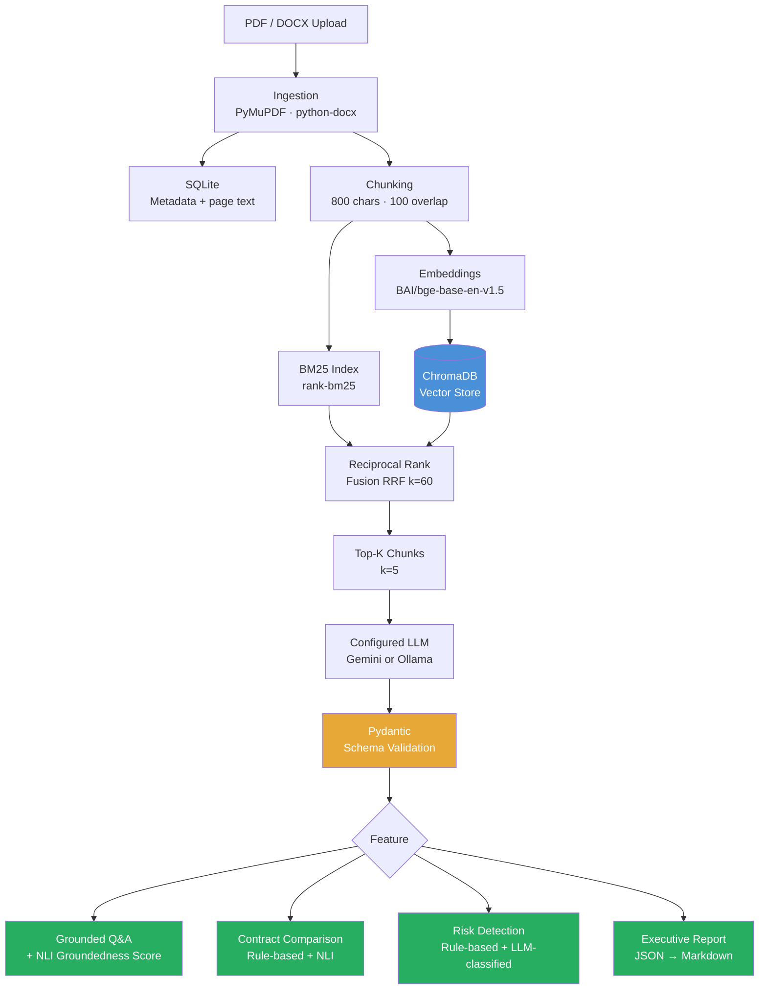

# Contract Intelligence Platform

An AI-powered contract analysis tool that lets you upload contracts (PDF/DOCX)
and query, compare, and assess them — with every answer grounded in a retrieved
passage and verified by an independent NLI entailment check.

Built as a portfolio project demonstrating hybrid retrieval, structured LLM
output with Pydantic validation, NLI-based groundedness scoring, and a
documented evaluation methodology.

---
## Live Demo

**Try the deployed application:** [Contract Intelligence Platform](https://contract-intelligence-platform-fmcudnumzmzkpqx8tkfrgg.streamlit.app/)

Explore AI-powered contract analysis, grounded question answering, contract comparison, risk assessment, and executive report generation.

> **Note:** Upload a sample PDF or DOCX contract to explore the application's features. Answers depend on the uploaded documents and configured LLM provider.

## Architecture



---

## Features

### 1 · Grounded Contract Q&A
Ask any question about an uploaded contract. The system retrieves relevant
passages via hybrid BM25 + vector search, asks the LLM to answer strictly from
those passages, and verifies the answer with an independent NLI entailment
check — not a self-reported confidence number.

- Returns `NOT_FOUND_IN_CONTRACT` rather than hallucinating when evidence is absent
- Every answer carries: contract name, page number, exact supporting text, and
  an entailment score from `DeBERTa-v3-base-mnli-fever-anli`

### 2 · Contract Comparison
Extracts structured fields from two contracts (payment terms, dates, termination,
confidentiality, liability, renewal, obligations) and detects inconsistencies via:

- **Rule-based:** deterministic numeric and date comparison (e.g. Net 30 vs Net 60)
- **NLI-based:** bidirectional semantic contradiction detection for clause text

### 3 · Risk Detection
Hybrid pipeline scoring 0–100 with a documented, deterministic formula:

| Category | Method | Weight |
|---|---|---|
| Missing signature field | Rule-based (clause absence) | 25 |
| Missing termination clause | Rule-based (clause absence) | 20 |
| Missing confidentiality clause | Rule-based (clause absence) | 15 |
| Unlimited indemnity language | LLM-classified (Pydantic-validated JSON) | 20 |
| High liability exposure | LLM-classified (Pydantic-validated JSON) | 15 |
| Ambiguous payment terms | LLM-classified (Pydantic-validated JSON) | 10 |

`risk_score = min(sum(weight for each triggered flag), 100)`

The LLM classifies triggered/not-triggered against a fixed taxonomy and must
supply a citation for every flag. Pydantic validation with auto-retry ensures
the output always conforms to the schema before any value is trusted.

### 4 · Executive Summary Report
JSON-first pipeline: LLM → `_LLMReportOutput` (Pydantic) → `ReportSchema` →
Markdown renderer. The LLM never generates Markdown directly. Every factual
claim in the report carries a contract name + page number citation.
Download as `.md`.

---

## Evaluation Results

Measured on 20 synthetic PDF contracts with planted inconsistencies and known
risk flags. Run `python scripts/run_evaluation.py` to reproduce.

### A · Inconsistency Detection (rule-based, 5 comparison pairs)

| Metric | Value |
|---|---|
| Precision | **1.00** |
| Recall | **1.00** |
| F1 | **1.00** |
| TP / FP / FN | 4 / 0 / 0 |

### B · BM25 Retrieval Recall (20 questions, 120 total chunks)

| Metric | Value |
|---|---|
| Recall@1 | 0.15 |
| Recall@3 | 0.55 |
| Recall@5 | **0.70** |
| MRR | 0.38 |

> Recall@1 of 0.15 is an honest result on a corpus of 20 nearly identical
> contract templates where BM25 alone cannot semantically disambiguate which
> contract's chunk is most relevant. This motivates the hybrid pipeline: vector
> search adds the semantic signal BM25 lacks. See `docs/DESIGN_DECISIONS.md §1`.

### C · Rule-Based Risk Detection (20 contracts, 3 flag categories)

| Metric | Value |
|---|---|
| Precision | **1.00** |
| Recall | **1.00** |
| F1 | **1.00** |
| TP / FP / FN | 10 / 0 / 0 |

### D · Schema Validation Rate (25 synthetic LLM responses)

| Metric | Value |
|---|---|
| First-attempt pass rate (valid responses) | **1.00** |
| Correct rejection rate (invalid responses) | **1.00** |
| Overall accuracy | **1.00** |

### E–G · Model-Dependent Metrics

| Metric | Status |
|---|---|
| NLI groundedness rate | `REQUIRES_MODEL`: DeBERTa-v3-base-mnli-fever-anli |
| Vector retrieval recall | `REQUIRES_MODEL`: BAAI/bge-base-en-v1.5 |
| LLM structured output validity (live) | `REQUIRES_MODEL`: configured Gemini or Ollama provider |

The evaluation harness (`evaluation/eval_harness.py`) and runner
(`scripts/run_evaluation.py`) are fully built. These metrics produce real
numbers when run with the full model stack.

---

## Performance Optimization Results

The timings below are individual wall-clock spans recorded in the application
performance logs, not averages. They describe observed executions and should
not be read as a controlled production benchmark.

### Cache-cold and warm observations

| Workflow / metric | Earlier (cold) | Later (warm) | Elapsed-time change | Conditions and outcome |
|---|---:|---:|---:|---|
| Ingestion + indexing | 19.7713 s (Sep 14) | 0.8734 s (Sep 14) | **95.6% lower** | Cold phase logged embedding-model loading (18.1229 s). One sample per phase. |
| Ingestion + indexing, separate run | 19.5315 s (Oct 12) | 1.3030 s (Oct 12) | **93.3% lower** | Cold phase logged embedding-model loading (17.7744 s). Warm embedding/indexing work still took time. |
| Q&A | 11.1411 s (Sep 14) | 6.6161 s (Sep 14) | **40.6% lower** | Gemini `gemini-3.6-flash`; one request per phase. Cold sequence logged NLI model loading (2.0116 s). |
| Risk assessment | 10.6119 s (Sep 14) | 9.5839 s (Sep 14) | **9.7% lower** | Gemini `gemini-3.6-flash`; one request per phase. Small sample; no accuracy evaluation implied. |
| Report workflow | 22.2174 s (Sep 14) | 27.4403 s (Sep 14) | **23.5% higher** | Both report-complete events were logged. These outer spans include risk assessment; the warm run was slower. |

The log records show the cold-to-warm sequences in time order, but do not store
phase labels alongside these individual spans. They provide no repeated
samples or statistical summaries. Treat the pairs as indicative cache
observations, not estimates of typical latency.

### Historical observations and report outcomes

| Workflow / metric | Earlier observation | Later observation | Change | Interpretation |
|---|---:|---:|---:|---|
| Q&A request | 49.5249 s (Oct 10) | 9.7568 s (Oct 12) | **80.3% lower** (indicative) | Both logs show Gemini `gemini-3.6-flash`. Earlier: embedding-model loading 36.6024 s and hybrid retrieval 38.7969 s; later retrieval 0.3640 s. Different cache/retrieval conditions make this non-controlled. |
| Report generation | 454.6337 s; failed after retries (Oct 12) | 11.6040 s report LLM span; succeeded (Oct 12) | Not a controlled speed comparison | Earlier enclosing request: 455.0457 s, with repeated provider/fallback attempts and a final logged Ollama call of 120.5730 s. Later report-only request: 11.9942 s overall and report-complete logged. Outcomes, retries, and provider paths differ. |
| Full report workflow | — | 64.6807 s; succeeded (Oct 12) | Not comparable to report-only | Included field extraction, risk assessment, and report generation. The logs verify 64.6807 s; the separately cited ~65.52 s was not found as an exact log measurement. |

### Methodology and limits

- First requests can be slower because embedding, NLI, or other models load on
  demand. A warm run in the same process is not equivalent to a fresh-process
  startup measurement.
- LLM latency varies with provider availability, generation time, and retries.
  Failed attempts are reported as failures, not successful performance results.
- The percentages use `((earlier - later) / earlier) * 100`. Historical
  cross-run comparisons are labeled indicative when cache state or workflow
  conditions differ; no percentage is claimed for unlike report outcomes.
- Structured validation and workflow completion matter alongside elapsed
  time. These logs do not establish improved classification accuracy; that
  would require a representative evaluation dataset and measured results.

---

## Tech Stack

| Layer | Technology |
|---|---|
| Frontend | Streamlit 1.39 |
| LLM | Gemini · gemini-3.6-flash (workflow default); Ollama · llama3.1:8b (configurable/fallback) |
| RAG Framework | LangChain (retrieval plumbing) |
| Embeddings | `BAAI/bge-base-en-v1.5` via sentence-transformers |
| Vector DB | ChromaDB 0.5 (persistent, HNSW cosine) |
| Keyword Search | rank-bm25 (BM25Okapi) |
| Fusion | Reciprocal Rank Fusion (k=60) |
| NLI / Groundedness | `MoritzLaurer/DeBERTa-v3-base-mnli-fever-anli` |
| NER (obligations) | `dslim/bert-base-NER` via transformers |
| Document Parsing | PyMuPDF (PDF) · python-docx (DOCX) |
| Metadata Storage | SQLite (WAL mode) |
| Validation | Pydantic v2 (all structured outputs) |
| Configuration | YAML (`config/settings.yaml`, `config/retrieval.yaml`) |
| Prompts | Externalized `.txt` files under `prompts/` |
| Logging | Python `logging` (rotating file + console) |
| Testing | pytest (see `tests/`) |

---

## Folder Structure

```
contract-intelligence-platform/
├── app.py                          # Streamlit entry point
├── app/
│   ├── frontend/                   # Streamlit pages and shared components
│   │   ├── state.py
│   │   ├── components.py
│   │   └── pages/
│   │       ├── upload_page.py
│   │       ├── qa_page.py
│   │       ├── compare_page.py
│   │       ├── risk_page.py
│   │       └── report_page.py
│   ├── ingestion/                  # PDF/DOCX parsing + file storage
│   ├── chunking/                   # Overlapping chunker + indexing pipeline
│   ├── embeddings/                 # Embedder + ChromaDB wrapper
│   ├── retriever/                  # BM25 index + RRF fusion + hybrid retriever
│   ├── extraction/                 # Keyword classifier + date + NER obligations
│   ├── comparison/                 # Field aligner + rule-based + NLI comparison
│   ├── risk/                       # Rule-based flags + LLM classifier + scorer
│   ├── groundedness/               # NLI entailment checker
│   ├── llm/                        # Provider factory, Gemini/Ollama providers, prompts, QA service
│   ├── reports/                    # JSON generator + Markdown renderer
│   ├── models/                     # Pydantic schemas (all data contracts)
│   ├── database/                   # SQLite connection + repository
│   └── utils/                      # Config loader + logging setup
├── config/
│   ├── settings.yaml               # App, LLM, embedding, risk weight config
│   ├── retrieval.yaml              # chunk_size=800, chunk_overlap=100, top_k=5
│   └── extraction_keywords.yaml   # Clause-type keyword patterns
├── prompts/
│   ├── qa_prompt.txt
│   ├── comparison_prompt.txt
│   ├── risk_prompt.txt
│   └── summary_prompt.txt
├── scripts/
│   ├── generate_synthetic_contracts.py
│   └── run_evaluation.py
├── evaluation/
│   ├── eval_harness.py             # Metric computation functions
│   ├── ground_truth.json           # Generated labeled test set
│   ├── test_contracts/             # 20 synthetic PDF contracts
│   └── results/                    # JSON + CSV metric outputs
├── docs/
│   └── DESIGN_DECISIONS.md        # Rationale for every architectural choice
├── tests/                          # 304 pytest tests
├── requirements.txt
├── .env.example
└── .gitignore
```

---

## Installation

**Prerequisites:** Python 3.12 and a Gemini API key for the configured
workflows. Ollama can be run locally as the configured fallback/provider.

```bash
# 1. Clone
git clone https://github.com/your-username/contract-intelligence-platform.git
cd contract-intelligence-platform

# 2. Install dependencies
pip install -r requirements.txt

# 3. Optional: install/run Ollama for local generation or fallback
ollama pull llama3.1:8b

# 4. Copy environment config
cp .env.example .env
```

---

## Running Locally

```bash
streamlit run app.py
```

Open `http://localhost:8501` in your browser.

### Streamlit Community Cloud

Deploy `app.py` from the repository root with Python 3.12. In the app's
Community Cloud **Advanced settings → Secrets**, add:

```toml
GEMINI_API_KEY = "your-key"
LLM_PROVIDER = "gemini"
LLM_FALLBACK_TO_OLLAMA = "false"
```

The key is read from the process environment first, then from Streamlit
Secrets. `LLM_PROVIDER` selects Gemini for Q&A, Risk, and Report workflows;
disabling fallback prevents the app from requiring a local Ollama server.
Local `.env` values and the YAML provider/fallback defaults remain supported.
Do not commit a local `.env` or `.streamlit/secrets.toml` file. The configured
model identifier is [`gemini-3.6-flash`](https://ai.google.dev/gemini-api/docs/models/gemini-3.6-flash);
Google's model documentation lists it as stable and supporting structured
outputs.

**First run:** the embedding model (`bge-base-en-v1.5`) and NER model
(`bert-base-NER`) download automatically on first upload. This takes a few
minutes and requires internet access.

---

## Running the Evaluation

```bash
python scripts/run_evaluation.py
```

Generates 20 synthetic contracts, runs the full extraction + comparison + risk
pipeline, and writes results to `evaluation/results/metrics_<timestamp>.json`
and `.csv`.

---

## Running Tests

```bash
pytest tests/
```

The test suite is run with `pytest tests/`. Evaluation and model-backed tests
may require local model files or provider credentials, as indicated by the
individual test setup.

---

## Configuration

All tuneable parameters are in `config/` — no magic numbers in Python files.

| File | Key settings |
|---|---|
| `settings.yaml` | LLM providers/models, global timeout (120 s), Gemini timeout (30 s), Ollama timeout (600 s), embedding model, risk weights |
| `retrieval.yaml` | `chunk_size: 800`, `chunk_overlap: 100`, `top_k: 5`, `rrf_k: 60` |
| `extraction_keywords.yaml` | Clause-type keyword patterns (editable without touching Python) |

---

## Design Decisions

See [`docs/DESIGN_DECISIONS.md`](docs/DESIGN_DECISIONS.md) for detailed rationale on:

- Why hybrid retrieval (BM25 + vector) over either alone
- Chunk size and overlap choices
- Why DeBERTa-v3 for groundedness over LLM self-reported confidence
- Why clause extraction uses keyword matching rather than NER
- The rule-based vs. LLM risk classification split
- The JSON-first report pipeline
- DOCX pagination approximation and its documented limitation
- SQLite vs. ChromaDB separation of concerns
- Honest evaluation scope and what `REQUIRES_MODEL` means

---

## Future Improvements

Explicitly out of scope for this project (depth over breadth):

- **Conversation history persistence** — Q&A history across sessions
- **OCR support** — scanned or image-only PDFs
- **Multi-format report export** — PDF/DOCX report rendering (Markdown only now)
- **FastAPI backend** — currently a single Streamlit app; a REST API layer would
  enable multi-client and async use cases
- **Model fine-tuning** — fine-tuned legal NER for clause-type classification
  (currently keyword-based; fine-tuning is out of scope per project rules)
- **Dark mode / UI theming**
- **Multi-user session isolation** — currently single-user Streamlit session state
